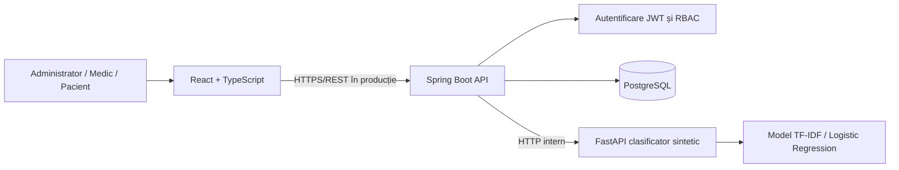
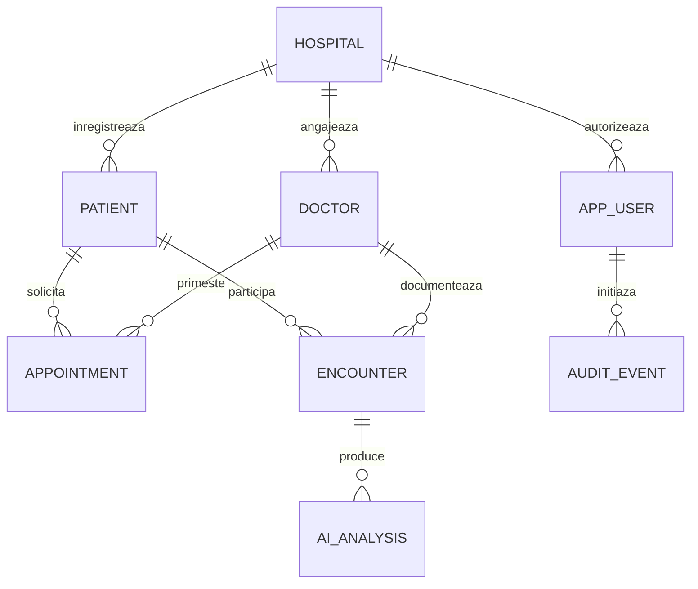

# Arhitectura MedFlow — MVP

Starea curentă este detaliată în [CERINTE_CF_CNF.md](CERINTE_CF_CNF.md); această prezentare a modelului inițial se completează cu migrațiile V2–V7. Rolul STAFF are acces la dosare numai prin relațiile/acordările autorizate, își consultă turele și nu confirmă decizii clinice.

Documentul detaliat de trasabilitate și starea actuală a extensiilor sunt în [CONFORMITATE_MEDFLOW.md](CONFORMITATE_MEDFLOW.md).

## 1. Context și scop

Proiectul „Sistem de gestionare pentru spitale cu suport decizional clinic” propune o platformă integrată destinată spitalelor și clinicilor. Funcționalități urmărite: gestionarea pacienților, personalului, programărilor și dosarelor medicale electronice, plus o componentă distinctă de suport decizional clinic. Acest repository implementează doar o **versiune demonstrativă** a acestui plan.

## 2. Module și interacțiuni

Backendul are structură modulară, dar este **un singur proces Java**; acesta permite extinderea fără a introduce complexitatea operațională a unei arhitecturi exclusiv cu microservicii.

## 3. Modelul relațional de bază

Schema de bază V1 conține `hospitals`, `doctors`, `patients`, `app_users`, `appointments`, `encounters`, `ai_analyses` și `audit_events`. V2 întărește cheile externe și rezervările concurente. V3 adaugă cele nouă tabele ale dosarului extins, descrise în documentul de conformitate.

## 4. Autorizații demonstrative

| Operație | Admin | Medic | Pacient |
|---|---|---|---|
| Vizualizare pacienți ai spitalului | Da | Numai pacienți asociați | Numai propriul profil |
| Înregistrare pacient | Da | Da | Nu |
| Creare programare | Da | Numai la propriul profil de medic | Numai pentru sine |
| Schimbare status programare | Da | Doar programările proprii | Nu |
| Creare consultație | Da | Numai sub propriul profil de medic | Nu |
| Vizualizare consultații | Spital | Proprii sau partajate explicit | Numai ale sale |
| Analiză AI demo | Da | Doar consultațiile create sub propriul profil de medic | Nu |
| Audit | Da | Nu | Nu |

**Starea actuală:** relația medic–pacient este verificată de `AccessPolicy`, iar citirile datelor clinice sunt auditate. Pentru producție sunt necesare în plus politici de consimțământ, expirarea relațiilor și revizuirea drepturilor.

## 5. Fluxul AI didactic

1. Medicul creează o consultație cu simptome/observații **fictive**.
2. Backendul verifică spitalul, rolul și dreptul de a analiza consultația.
3. Se trimite către FastAPI numai textul simptome/observații, nu numele și ID-ul pacientului.
4. Clasificatorul TF-IDF + regresie logistică, antrenat pe 2.250 de exemple TRAIN din datasetul sintetic de 3.000; modelele sunt încărcate din artefactul salvat, returnează o categorie didactică și o explicație limitată.
5. Rezultatul este stocat separat în `ai_analyses`. Nu se creează automat un diagnostic.

Niciuna dintre categoriile modelului nu poate fi utilizată ca prioritate medicală reală.

## 6. Extinderi sugerate

- consimțăminte și partajare inter-spital; cele nouă entități propuse în documentul MedFlow sunt implementate în V3;
- componente și standarde de interoperabilitate HL7 FHIR (Patient / Encounter / Observation / Appointment / Condition);
- autorizare contextuală, IDP, MFA, criptare și secrete gestionate centralizat;
- disponibilitate reală pe calendar și notificări; concurența este protejată acum la nivel PostgreSQL;
- audit complet al accesului, backup, teste de securitate și controale GDPR;
- modele de cercetare clinică validate separat de prototipul actual.
